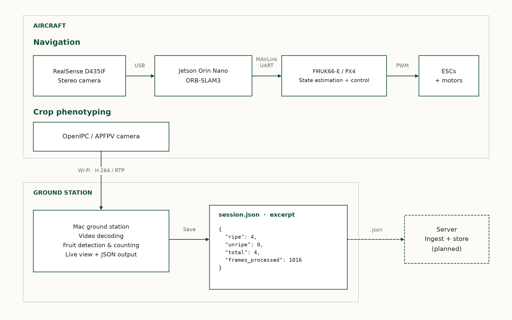
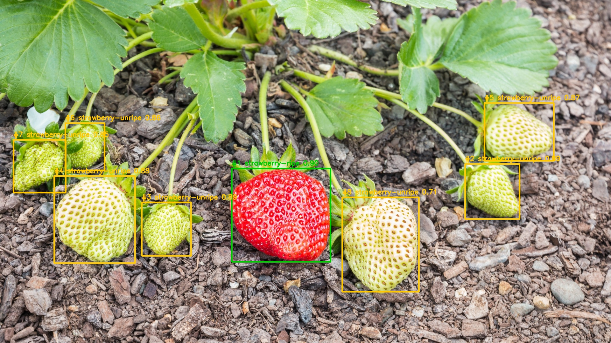

# AD4PT · OpenIPC Crop Phenotyping

**Autonomous Drone for Plant Telemetry — live strawberry detection and counting
from a dedicated crop camera.**

AD4PT explores how an OpenIPC camera on a drone can become a practical crop
observation system. A secondary RGB camera streams crop imagery to a ground
station, where YOLO11s detects ripe and unripe strawberries and BoT-SORT associates
detections across frames. An operator sees the results during streaming, and each
session ends with a structured JSON count summary.


*AD4PT Prototype 1: the aircraft, its dedicated OpenIPC crop camera, and a live
detection example using artificial fruit and foliage.*

[System architecture](#system-architecture) · [Detection and tracking](#detection-and-tracking) ·
[Quick start](#quick-start) · [Counting modes](#results-and-counting-modes) ·
[Development](#development)

## The project

Crop phenotyping turns observable plant characteristics into measurements. This
prototype focuses on two visual traits: **visible strawberry count** and
**apparent ripeness category**. These observations are a starting point for
studying fruit load and maturity distribution; they do not measure hidden fruit,
fruit mass, biochemical maturity, or total harvestable yield.

The wider AD4PT platform brings together autonomous navigation and crop
observation. This repository implements the **ground-station phenotyping
subsystem**: video reception, detection, tracking or fixed-scene counting, live
preview, and session export. The aircraft and navigation components provide the
project context; flight control is outside this codebase.

## Why OpenIPC? The system contribution

[OpenIPC](https://github.com/OpenIPC/firmware) provides an alternative IP-camera
firmware ecosystem. AD4PT uses an OpenIPC/APFPV camera as a dedicated sensing
payload and connects its H.264 RTP stream directly to a crop-analysis application.

The project's novelty lies in **integrating the camera, wireless video link, and
live phenotyping workflow**. Its main design contributions are:

- **A separate crop-observation camera.** Crop imaging can use a viewing direction
  and framing suited to fruit inspection, while the navigation camera serves pose
  estimation and aircraft movement.
- **Analysis during acquisition.** Frames flow from the camera into detection and
  counting while the stream is active. The operator can inspect detections
  immediately, without first recording and transferring a complete video.
- **Ground-station inference.** The crop camera supplies compressed video; the Mac
  runs the detector and counting logic. This separates the camera payload from
  the compute used for phenotyping and allows model changes on the receiver.
- **A reusable measurement workflow.** Configurable stream and model settings,
  temporal confirmation, optional raw-frame captures, and JSON summaries connect
  image acquisition to experiments that can be inspected and repeated.

This is a system integration contribution built from existing firmware,
detection, and tracking methods. The current prototype demonstrates a route from
an OpenIPC video feed to crop observations; establishing research priority or
field performance requires a separate comparative evaluation.

## System architecture



*Wider platform architecture. This repository implements the crop-camera receiver
and Mac processing path through JSON export. The navigation stack is shown for
context; server ingestion is planned.*

The implemented data path is:

```text
OpenIPC / APFPV crop camera
  → Wi-Fi · H.264 / RTP over UDP
  → GStreamer decode · latest-frame delivery
  → YOLO11s ripe / unripe detections
  → BoT-SORT tracking OR fixed-scene confirmation
  → live preview + one JSON summary at session end
```

Bounded queues and latest-frame delivery prioritize recent imagery when inference
is slower than the camera. The application does not promise to process every
frame. Inference runs on the ground station; measured end-to-end latency and
hard real-time guarantees are not established.

## Detection and tracking



*BoT-SORT smoke test, image 2. Green boxes indicate ripe predictions; yellow boxes
indicate unripe predictions. Labels show track IDs and detector confidence.*

The saved smoke-test result reports **1 ripe + 7 unripe = 8 confirmed tracks**
after eight repeated copies of the same photograph, with confirmation requiring
three qualifying observations. The visible detections matched the detector-only
output on all eight frames. This checks detection-to-tracker association and
count confirmation on a static input. It does not test camera motion, occlusion,
or distinct-fruit counting during flight. These are system predictions rather
than an independently annotated accuracy result.

BoT-SORT adds identities to the detector's original boxes, scores, and classes.
Confirmed IDs count once within a session, helping avoid adding the same visible
fruit again in every frame. A separate fixed-scene mode estimates one stationary
arrangement without accumulating track IDs. See
[counting behavior and limitations](documents/counting.md).

## Current scope

The live configuration targets an **Apple Silicon Mac** receiving an **H.264 RTP
stream over UDP**. A camera, desktop display, and separately downloaded model
weights are required. Automated tests run without a camera or model weights.
The repository also includes tools for dataset preparation, fine-tuning, and
fixed-threshold evaluation.

Real-field accuracy and unique-fruit counting along a flight path remain open
validation tasks. The prototype image, static smoke test, and controlled replica
tests demonstrate different parts of the workflow and should be interpreted
separately.

## Quick start

### 1. Install the environment

Install Conda, then clone the repository and create the environment from its root:

```bash
git clone https://github.com/aditya-aryamaan/AD4PT_Phenotyping.git
cd AD4PT_Phenotyping
conda env create -f environment.yml
conda activate ad4pt
python -m pip check
```

The recipe installs Python 3.12, GStreamer, PyGObject, and the project's inference
dependencies. Use this environment for every command below. Run commands from the
repository root: the default config paths are relative to it.

### 2. Obtain the model

Weights are excluded from this repository. The default configuration expects the
pinned upstream checkpoint below. See its [model provenance](documents/model.md)
before downloading or redistributing it.

```bash
mkdir -p models/strawberry-yolo11s
curl --fail --location --retry 3 \
  'https://huggingface.co/shivamjha98/yolo11s-strawberry-detection/resolve/4c2fbec408c569063751b124f6f36e6ed313ad61/strawberry_yolo_best.pt' \
  --output models/strawberry-yolo11s/strawberry_yolo_best.pt
shasum -a 256 models/strawberry-yolo11s/strawberry_yolo_best.pt
```

Expected SHA256:

```text
566a60e937bd7cbfffce6fd050e1d53bdda5119d01a31a35c54efd6653378b48
```

The application checks this hash before loading. A different checkpoint requires
its own model path, hash, and matching class list in the detector JSON.

### 3. Configure the camera stream

Connect the Mac to the camera's network. Configure the sender to transmit
**H.264 RTP**, payload type **96**, clock rate **90000**, to the Mac's IP address
on **UDP port 5600**. Raw H.264 and MPEG-TS UDP streams are different formats.

The original APFPV setup used camera `192.168.0.1` and receiver `192.168.0.10`;
use addresses appropriate to your network. Stop other receivers using the same
port and allow incoming UDP traffic if prompted by the operating system.

Check that the configured Apple hardware decoder is available:

```bash
gst-inspect-1.0 vtdec_hw
```

Camera settings live in [config/live_apfpv.yaml](config/live_apfpv.yaml). The
supplied recipe uses `vtdec_hw`; CPU inference does not change the video decoder.
Other operating systems and decoder configurations have not been validated.

### 4. Run

```bash
python -u -m ad4pt demo
```

The default uses Apple MPS inference and cumulative BoT-SORT tracking. For CPU
inference, add `--device cpu`. For a **fixed view** of one arrangement, use:

```bash
python -u -m ad4pt demo --counting-mode scene
```

Stop with **Q**, **Esc**, the preview window's close button, or **Ctrl-C**.
If frames stop arriving, the app exits after the configured timeout (10 seconds).
It prints the saved JSON path and summary to the terminal.

## Results and counting modes

Each session saves one file under `runs/`, named with its start time in
`Pacific/Auckland` (`NZST` or `NZDT`). JSON timestamps use UTC. Same-second runs
receive a numeric suffix. Results include ripe/unripe/total counts, processed
frames, timestamps, stop reason, counting method, and counting settings.

Choose a filename with `--output runs/example.json`; this replaces an existing
file at that path. A startup stream timeout produces zero counts and
`stop_reason: "no_stream"`. A handled runtime error saves counts so far with
`stop_reason: "error"`. Inspect the stop reason before interpreting a result.
Force-killing the process or losing power cannot trigger a final save.

| Mode                 | Intended use                              | What contributes to the result                                                                                                          |
| -------------------- | ----------------------------------------- | --------------------------------------------------------------------------------------------------------------------------------------- |
| `tracks` (default) | Moving views                              | Each BoT-SORT ID confirmed in at least three qualifying observations counts once.                                                       |
| `scene`            | One stationary, fully visible arrangement | Boxes need five consecutive matching detections; the most frequent joint ripe/unripe count pair needs at least three supporting frames. |

Counts are estimates. Missed fruit, foliage false positives, occlusion, and ID
changes affect results. Fruit leaving and re-entering view can count twice in
tracking mode. Scene mode does not count unique fruit across changing views.
See [counting behavior and settings](documents/counting.md) for details.

## Configuration and useful options

| File or option                                                  | Purpose                                                                        |
| --------------------------------------------------------------- | ------------------------------------------------------------------------------ |
| [config/live_apfpv.yaml](config/live_apfpv.yaml)                 | RTP port, payload, decoder, expected stream properties, timeout.               |
| [config/strawberry_yolo11s.json](config/strawberry_yolo11s.json) | Checkpoint identity, class list, input size, confidence, crop and box filters. |
| [config/strawberry_botsort.yaml](config/strawberry_botsort.yaml) | Track confirmation and retention settings.                                     |
| `--device cpu`                                                | Run inference on CPU instead of MPS.                                           |
| `--max-frames 100`                                            | End after 100 processed frames.                                                |
| `--run-root PATH`                                             | Change the result directory.                                                   |
| `--capture-dir datasets/camera-errors`                        | Enable **S** in the preview to save the latest raw frame.                |
| `--scene-confirmation-frames N`                               | Require 1–60 consecutive matching frames in scene mode.                       |
| `--unripe-confidence 0.5`                                     | Apply a stricter unripe threshold; may also hide genuine green fruit.          |

The supplied detector config crops the top **8%** to exclude the original camera's
OSD and rejects boxes covering more than **15%** of the remaining image. These
settings can remove real fruit. Adjust `ignore_top_fraction` and
`max_box_area_fraction` for your camera and viewing distance.

View all CLI options with `python -m ad4pt demo --help`.

## Troubleshooting

- **Missing checkpoint or hash mismatch:** check the download, expected hash, and
  `model_path` in the detector config. Paths inside that JSON resolve relative to
  the config file.
- **Missing `gi` or GStreamer plugin:** activate the Conda environment and rerun
  `gst-inspect-1.0 vtdec_hw`. A standalone pip installation does not supply the
  native GStreamer runtime.
- **No video / `no_stream`:** check the sender's destination IP, RTP format,
  payload type, port, network connection, and firewall. Check for another receiver.
- **MPS unavailable:** use `--device cpu`.
- **Wrong counts:** capture raw frames, compare with manual counts, and inspect
  crop/area filters before changing confidence settings.

## Development

Tests use synthetic fixtures, mocked inference/video backends, and the real
BoT-SORT backend. From the
repository root, with a Python 3.11+ environment:

```bash
python -m pip install -e '.[vision,dev]'
ruff check .
mypy
pytest -q
```

The live demo additionally requires the vision dependencies and native runtime
installed by `environment.yml`. See [CONTRIBUTING.md](CONTRIBUTING.md) for checks
and [the fine-tuning guide](documents/model-finetuning.md) for dataset preparation,
training, and validation. Training images and candidate weights are not included.

```text
config/       Camera, detector, tracker, and training recipes
documents/    Usage, model provenance, and fine-tuning guides
pictures/     Project overview, system architecture, and tracking example
scripts/      Dataset preparation, evaluation, and reporting tools
src/ad4pt/    Live receiver, detector, counting, and CLI
tests/        Automated tests and small synthetic fixtures
```

Datasets, weights, recordings, generated reports, run outputs, and local research
archives are excluded from Git.

## Author and acknowledgements

**Author :** [Aditya Aryamaan](https://github.com/aditya-aryamaan)

Master of Robotics and Automation Engineering, University of Auckland.

AD4PT is developed for laboratory research into drone-based crop observation and
visual phenotyping, with strawberry detection and counting as the current focus.

The system builds on the work of the OpenIPC community, Ultralytics YOLO11, and
the BoT-SORT authors. The pretrained strawberry checkpoint is credited in the
[model provenance notes](documents/model.md).
